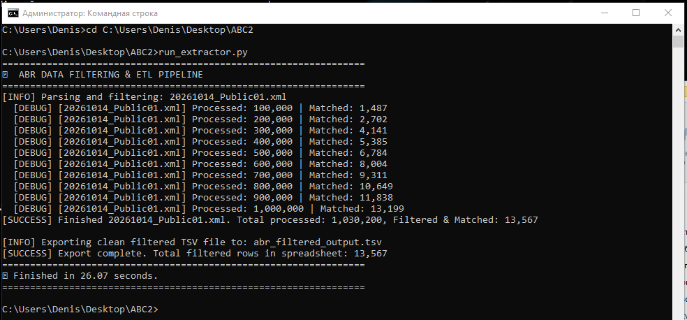

# 🚀 ABR Bulk Data Streaming ETL Pipeline

## 📌 Overview
A high-performance, memory-efficient ETL (Extract, Transform, Load) pipeline built in Python to process massive Australian Business Register (ABR) bulk XML datasets. The pipeline streams multi-gigabyte XML files, filters target legal entity types, and exports clean, structured datasets ready for business analysis and Excel reporting.

---

## 🛠️ Tech Stack & Libraries
- **Language:** Python 3.x
- **Parsing:** `lxml` (`etree.iterparse`) — for high-speed, memory-efficient streaming XML processing.
- **Data Management:** `pandas`, built-in `csv` module.
- **Output Format:** TSV (Tab-Separated Values) with `UTF-8-SIG` encoding for seamless Excel integration.

---

## ⚙️ Key Architectural Features
1. **Zero OOM (Out-of-Memory) Risk:** Utilizes iterative event-driven parsing (`iterparse`) combined with DOM node clearing (`elem.clear()`) to process arbitrarily large XML files with a constant, minimal memory footprint.
2. **Robust Delimiter Management:** Switches from standard CSV to TSV formatting to completely eliminate data corruption caused by commas within corporate organization names.
3. **Strict Business Logic Filtering:** Automated filtering tailored to extract specific legal structures: **Public Company Limited by Guarantee** (`PUB`) and **Other Incorporated Entity** (`OIE`).

---

## 💻 Execution Output & Performance
Пример работы пайплайна в консоли (обработка более 1 млн записей за 26 секунд):

